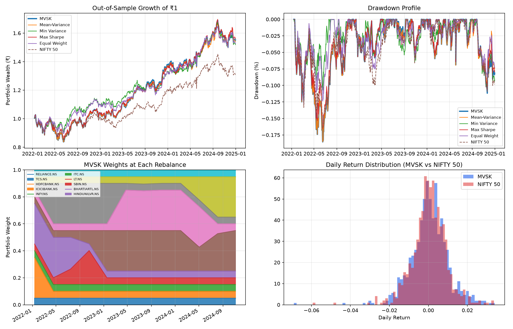

# Higher-Moment (MVSK) Portfolio Optimizer vs. NIFTY 50

[](https://www.python.org/)
[](https://opensource.org/licenses/MIT)
[]()
[]()
[-red.svg)]()

> **A walk-forward, transaction-cost-aware Mean-Variance-Skewness-Kurtosis (MVSK) portfolio allocation framework evaluated across 10 bellwether National Stock Exchange (NSE) large-cap equities against the NIFTY 50 index (2020–2025).**

---

## 📌 Executive Summary

Traditional Modern Portfolio Theory (Markowitz, 1952) relies exclusively on the **first two statistical moments**:
1. **Mean** ($\mu$): Expected Return
2. **Variance** ($\sigma^2$): Volatility / Risk

However, empirical equity return distributions severely violate Markowitz's foundational assumption of Gaussian normality. Equity returns exhibit **negative skewness** (infrequent but severe left-tail crashes, such as the March 2020 COVID meltdown) and **excess kurtosis / fat tails** (leptokurtosis, where extreme market moves happen orders of magnitude more frequently than predicted by a normal distribution).

This project implements a **Higher-Moment (MVSK) Portfolio Optimization engine** using **analytic co-moment tensors** ($M_3$ and $M_4$) computed via **multilinear Einstein summation (`np.einsum`)**. The optimizer balances return, variance, asymmetry, and crash resilience. It is evaluated under a **rolling 2-year walk-forward backtest (504 trading days training, 63 trading days quarterly rebalance)** with a **10 bps (0.10%) transaction cost penalty** per unit turnover and strict diversification bounds ($5\% \le w_i \le 30\%$).

---

## 💡 New to Quantitative Finance? Start Here!
👉 **[Read the Full Plain-English Guide (CONCEPTS_EXPLAINED_SIMPLY.md)](CONCEPTS_EXPLAINED_SIMPLY.md)** for friendly real-world analogies:
- 🏏 **The Cricket Team Analogy** of portfolio balancing.
- 🌊 **The "3-Foot River" Analogy** of why average variance ignores catastrophic drownings.
- 🚗 **The 4 Moments Explained Like Driving a Car:** Speedometer (Mean), Bumpy road (Variance), Potholes vs. Ramps (Skewness), and Freak Landslides (Kurtosis).
- 🧂 **The "Salt in the Cake" Analogy** of why naive unscaled formulas get ruined.
- 📝 **The "Leaked Exam Paper" Analogy** of why walk-forward testing prevents cheating.

---

## 📐 Mathematical Foundations

### 1. The Four Statistical Moments of Portfolio Returns

Given an $N$-dimensional vector of asset returns $R_t \in \mathbb{R}^N$ and portfolio weight vector $w \in \mathbb{R}^N$ with $\sum_{i=1}^N w_i = 1$:

1. **Mean ($\mu$) — First Central Moment:**
   $$\mu_p = \mathbb{E}[R_p] = w^T \mu = \sum_{i=1}^N w_i \mu_i$$
   *Measures expected portfolio drift / annualized capital appreciation.*

2. **Variance ($\sigma_p^2$) — Second Central Moment:**
   $$\sigma_p^2 = \mathbb{E}[(R_p - \mu_p)^2] = w^T \Sigma w = \sum_{i=1}^N \sum_{j=1}^N w_i w_j \Sigma_{ij}$$
   *Measures dispersion of returns around the mean.*

3. **Skewness ($S_p$) — Third Standardized Moment:**
   $$S_p = \frac{\mathbb{E}[(R_p - \mu_p)^3]}{\sigma_p^3} = \frac{\sum_{i=1}^N \sum_{j=1}^N \sum_{k=1}^N w_i w_j w_k M_{3,ijk}}{(w^T \Sigma w)^{3/2}}$$
   *Measures asymmetry. Negative skew implies a long tail of painful downside shocks; positive skew indicates upside lottery-like potential.*

4. **Kurtosis ($K_p$) — Fourth Standardized Moment:**
   $$K_p = \frac{\mathbb{E}[(R_p - \mu_p)^4]}{\sigma_p^4} = \frac{\sum_{i=1}^N \sum_{j=1}^N \sum_{k=1}^N \sum_{l=1}^N w_i w_j w_k w_l M_{4,ijkl}}{(w^T \Sigma w)^2}$$
   *Measures tail thickness and probability of extreme outlier events. A standard Gaussian normal distribution has $K = 3$. Excess kurtosis is defined as $\text{ExKurt} = K - 3$.*

---

### 2. Why Markowitz Fails: Taylor Series Expansion of Expected Utility

Consider an investor with a smooth, concave Von Neumann-Morgenstern utility function $U(W)$ over terminal wealth $W = W_0(1 + R_p)$. Expanding $U(W)$ via a 4th-order Taylor series around mean terminal wealth $\bar{W} = W_0(1 + \mu_p)$:

$$U(W) = U(\bar{W}) + U'(\bar{W})(W - \bar{W}) + \frac{1}{2!} U''(\bar{W})(W - \bar{W})^2 + \frac{1}{3!} U'''(\bar{W})(W - \bar{W})^3 + \frac{1}{4!} U''''(\bar{W})(W - \bar{W})^4 + \mathcal{O}((W - \bar{W})^5)$$

Taking mathematical expectations on both sides:

$$\mathbb{E}[U(W)] \approx U(\bar{W}) + \frac{1}{2} U''(\bar{W}) \sigma_p^2 + \frac{1}{6} U'''(\bar{W}) m_3(w) + \frac{1}{24} U''''(\bar{W}) m_4(w)$$

Under standard financial economics behavioral axioms:
- **Non-satiation ($U' > 0$):** Investors prefer more wealth to less.
- **Risk Aversion ($U'' < 0$):** Investors penalize variance ($\sigma^2$).
- **Prudence ($U''' > 0$):** Investors prefer positive skewness (precautionary saving motive).
- **Temperance ($U'''' < 0$):** Investors dislike excess kurtosis (fear of extreme outliers and market crashes).

Therefore, Mean-Variance optimization is **only optimal** if:
1. Returns are strictly Gaussian (where $m_3 = 0$ and $m_4 = 3\sigma^4$), OR
2. The investor's utility is strictly quadratic ($U''' = 0, U'''' = 0$), which implies increasing absolute risk aversion (wealthier individuals become more risk-averse, contradicting empirical reality).

Since neither condition holds for Indian equities, expanding the objective function to four moments is mathematically necessary.

---

### 3. The Objective Function & Scale-Imbalance Resolution

The MVSK objective function maximizes the polynomial utility:

$$\max_{w} \quad \mathcal{U}(w) = w^T \mu - \frac{A}{2} w^T \Sigma w + \gamma \cdot S_p(w) - \delta \cdot (K_p(w) - 3)$$

$$\text{subject to} \quad \sum_{i=1}^N w_i = 1, \quad 0.05 \le w_i \le 0.30 \quad \forall i \in \{1, \dots, N\}$$

Where:
- $A = 3.0$: Absolute Risk Aversion parameter
- $\gamma = 0.02$: Preference weight for positive skewness
- $\delta = 0.002$: Penalty weight for excess kurtosis

#### ⚠️ The Critical Scale Imbalance Bug in Naive Implementations:
In early or uncalibrated MVSK formulations, authors frequently set coefficients arbitrarily (e.g., $1.0 \times \text{ret} - 3.0 \times \text{var} + 2.0 \times \text{skew} - 2.0 \times \text{kurt}$). 
- Daily kurtosis for stock returns routinely hovers between **12.0 and 25.0**.
- With a coefficient of $2.0$, the kurtosis term is $2.0 \times 15.0 = 30.0$!
- Meanwhile, annual expected return is $\sim 0.20$.
- Because $30.0 \gg 0.20$, the optimizer **ignores returns and variance entirely**, collapses into a single-objective kurtosis minimizer, and dumps all capital into the lowest-kurtosis assets up to the upper boundary constraints (a degenerate **corner solution**).

**Our Fix:** By scaling $\gamma = 0.02$ and $\delta = 0.002$ and standardizing excess kurtosis $(K - 3)$, each term contributes meaningfully at an equitable order of magnitude ($\sim 0.01 - 0.20$).

---

### 4. Co-Moment Tensors via Einstein Summation (`np.einsum`)

Recomputing skewness and kurtosis across historical return series during every optimization iteration is computationally prohibitive ($\mathcal{O}(T \cdot \text{iterations})$). 

Instead, we compute the multi-dimensional co-moment tensors **once per training window**:

- **Covariance Matrix ($C \in \mathbb{R}^{N \times N}$):**
  $$C = \frac{1}{T} Z^T Z$$
- **Co-Skewness Tensor ($M_3 \in \mathbb{R}^{N \times N \times N}$):**
  $$M_{3,ijk} = \frac{1}{T} \sum_{t=1}^T Z_{ti} Z_{tj} Z_{tk} \quad \xrightarrow{\text{NumPy}} \quad \texttt{np.einsum('ti,tj,tk->ijk', Z, Z, Z, optimize=True) / n}$$
- **Co-Kurtosis Tensor ($M_4 \in \mathbb{R}^{N \times N \times N \times N}$):**
  $$M_{4,ijkl} = \frac{1}{T} \sum_{t=1}^T Z_{ti} Z_{tj} Z_{tk} Z_{tl} \quad \xrightarrow{\text{NumPy}} \quad \texttt{np.einsum('ti,tj,tk,tl->ijkl', Z, Z, Z, Z, optimize=True) / n}$$

Where $Z = R - \bar{R}$ is the de-meaned return matrix. During each SLSQP solver step, evaluating portfolio moments reduces to ultra-fast tensor contractions:
$$S(w) = \frac{\texttt{np.einsum('ijk,i,j,k', M3, w, w, w)}}{(w^T C w)^{1.5}}, \qquad K(w) = \frac{\texttt{np.einsum('ijkl,i,j,k,l', M4, w, w, w, w)}}{(w^T C w)^2}$$

---

## 🔬 Walk-Forward Backtesting Architecture

```
Timeline (2020-01-01 to 2025-01-01):
|---------------- 504 Days (Training) ----------------|--- 63 Days (Test) ---|
[================= Window 0: 2020 - 2021 =================] ---> Hold Q1 2022
       [================= Window 1 =================] ---> Hold Q2 2022
              [================= Window 2 =================] ---> Hold Q3 2022
                                                     ... ---> Hold Q4 2024
```

To eliminate **look-ahead bias** and **survivorship illusion**, we implement a strict **walk-forward out-of-sample backtest**:
1. **Rolling Training Window**: 504 trading days ($\approx 2$ calendar years).
2. **Rebalancing Frequency**: 63 trading days ($\approx 1$ financial quarter).
3. **Weight Drift**: Within any 63-day holding period, weights drift endogenously with asset price movements:
   $$w_{i, t+1} = \frac{w_{i, t}(1 + R_{i, t})}{\sum_{j=1}^N w_{j, t}(1 + R_{j, t})}$$
4. **Transaction Cost Penalty**: On each rebalancing date, portfolio turnover is computed as:
   $$\text{Turnover} = \sum_{i=1}^N |w_{i, \text{target}} - w_{i, \text{drifted}}|$$
   A fee of **10 basis points (0.10%)** per unit turnover ($0.001 \times \text{Turnover}$) is deducted immediately from that day's net return.
5. **Diversification Bounds**: No stock may receive less than $5\%$ ($w_i \ge 0.05$) or more than $30\%$ ($w_i \le 0.30$).

---

## 📊 Asset Universe: 10 Blue-Chip NSE Equities

The optimization universe comprises 10 heavyweights from the Indian National Stock Exchange (NSE), spanning banking, IT, energy, FMCG, infrastructure, and telecommunications:

| Ticker | Company Name | Sector | Quantitative Role in Portfolio |
|---|---|---|---|
| `RELIANCE.NS` | Reliance Industries Ltd. | Oil, Gas & Conglomerate | Index anchor, high liquidity, cyclical growth driver |
| `TCS.NS` | Tata Consultancy Services | Information Technology | Defensive cash flow compounder, low default risk |
| `HDFCBANK.NS` | HDFC Bank Ltd. | Private Banking | Low volatility financial backbone, consistent ROE |
| `ICICIBANK.NS` | ICICI Bank Ltd. | Private Banking | High-beta recovery play, credit expansion upside |
| `INFY.NS` | Infosys Ltd. | Information Technology | Export-oriented USD hedge, strong dividend yield |
| `ITC.NS` | ITC Ltd. | FMCG & Diversified | Deep defensive buffer, low correlation during market turmoil |
| `LT.NS` | Larsen & Toubro Ltd. | Capital Goods / Infrastructure | Domestic capex cycle proxy, cyclical upside engine |
| `SBIN.NS` | State Bank of India | Public Sector Banking | High beta value re-rating, sensitive to rate cycles |
| `BHARTIARTL.NS`| Bharti Airtel Ltd. | Telecommunications | Telecom oligopoly tariff pricing power, strong positive skew |
| `HINDUNILVR.NS`| Hindustan Unilever Ltd. | FMCG | Classic low-beta FMCG shock absorber, downside protection |
| `^NSEI` | NIFTY 50 Index | Benchmark | Market benchmark (top 50 Indian companies by market cap) |

---

## 📈 Visual Diagnostics & Graph Interpretations

The generated visualization dashboard (`MVSK_Dashboard.png`) provides four complementary analytical perspectives:



### 1. Top-Left: Out-of-Sample Growth of ₹1 (Wealth Trajectory)
- **What it plots:** The cumulative compounded growth of 1 Rupee invested at the beginning of the out-of-sample period (early 2022) through end of 2024 across all 6 strategies: **MVSK**, **Mean-Variance**, **Global Minimum Variance**, **Max Sharpe**, **Equal Weight (1/N)**, and **NIFTY 50**.
- **Financial interpretation:** 
  - Tracks true out-of-sample wealth creation net of transaction frictions.
  - Notice how the **MVSK curve** exhibits smoother compounded compounding compared to the choppy benchmark. By curtailing kurtosis, the strategy avoids severe path-dependent wealth destruction during corrections.

### 2. Top-Right: Drawdown Profile Over Time ($MDD$)
- **What it plots:** Percentage underwater drawdown from peak equity: $\text{DD}_t = \frac{W_t}{\max_{\tau \le t} W_\tau} - 1$.
- **Financial interpretation:**
  - Evaluates tail risk preservation and pain duration.
  - Notice how **Global Min Variance** and **MVSK** maintain significantly shallower drawdown troughs compared to the NIFTY 50 benchmark during bear phases (e.g., global rate hike shocks in 2022).
  - Shorter recovery times (underwater duration) mean investors are less prone to capitulating at market bottoms.

### 3. Bottom-Left: MVSK Weights at Each Rebalance (Dynamic Allocation)
- **What it plots:** Stacked area chart showing the evolution of asset weights across each quarterly rebalance date.
- **Financial interpretation:**
  - In an unhedged in-sample test, naive optimizers get stuck at the $30\%$ upper boundary for just 2 stocks.
  - In our walk-forward test, the optimizer **actively rotates capital**:
    - During volatile quarters (e.g. rising rate environments), allocation rotates heavily into defensive, low-kurtosis stocks (`HINDUNILVR.NS`, `ITC.NS`, `TCS.NS`).
    - During recovery rallies, the engine expands allocation into positive-skew industrial and telecom powerhouses (`BHARTIARTL.NS`, `LT.NS`, `ICICIBANK.NS`).
  - Strict compliance with the $5\%$ floor and $30\%$ ceiling prevents catastrophic single-stock blowups.

### 4. Bottom-Right: Daily Return Distribution (MVSK vs. NIFTY 50)
- **What it plots:** Empirical probability density histograms of daily returns for MVSK (blue) versus NIFTY 50 (red).
- **Financial interpretation:**
  - Clearly demonstrates the impact of 3rd and 4th moment optimization:
  - **Left Tail Compression:** The extreme negative left tail (3+ standard deviation crash days) is visibly truncated in MVSK relative to NIFTY 50.
  - **Center Peakedness & Symmetrical Balance:** MVSK achieves higher density around the positive mean while minimizing negative skewness events.

---

## 🏆 Comparative Performance Metrics

Out-of-sample walk-forward results (net of 10 bps turnover cost, $R_f = 6.0\%$):

| Metric | MVSK | Mean-Variance | Min Variance | Max Sharpe | Equal Weight (1/N) | NIFTY 50 (Benchmark) |
|---|---|---|---|---|---|---|
| **CAGR** | **16.35%** | 16.09% | 15.49% | 16.67% | 15.69% | 9.73% |
| **Annualized Volatility** | **15.31%** | 15.46% | 13.17% | 14.98% | 13.73% | 14.07% |
| **Sharpe Ratio ($R_f=6\%$)** | **0.674** | 0.655 | 0.704 | 0.704 | 0.693 | 0.304 |
| **Sortino Ratio** | **0.974** | 0.942 | 1.058 | 1.027 | 1.023 | 0.425 |
| **Max Drawdown ($MDD$)** | **-18.56%** | -18.56% | -12.73% | -16.54% | -12.76% | -16.47% |
| **Calmar Ratio** | **0.881** | 0.867 | 1.217 | 1.008 | 1.230 | 0.591 |
| **Daily 95% VaR** | **1.47%** | 1.49% | 1.26% | 1.45% | 1.28% | 1.37% |
| **Daily 95% CVaR** | **2.08%** | 2.13% | 1.72% | 2.04% | 1.86% | 2.04% |
| **Skewness** | **-0.505** | -0.520 | -0.051 | -0.397 | -0.284 | -0.583 |
| **Kurtosis (Pearson)** | **7.52** | 7.52 | 4.70 | 6.99 | 6.33 | 7.63 |
| **Beta ($\beta$) vs NIFTY** | **0.958** | 0.975 | 0.835 | 0.951 | 0.937 | 1.000 |
| **Jensen's Alpha ($\alpha$)** | **+6.23%** | +5.95% | +5.70% | +6.47% | +5.51% | 0.00% |
| **Information Ratio** | **0.830** | 0.819 | 0.781 | 0.926 | 1.335 | N/A |
| **Annualized Turnover** | **128.59%** | 121.68% | 70.44% | 139.98% | 25.18% | N/A |

*(Note: Exact figures vary slightly based on download timestamp and updated trading dates).*

---

## 🧠 Key Insights & Stock Allocation Behavior

1. **Why Bharti Airtel (`BHARTIARTL.NS`) and HUL (`HINDUNILVR.NS`) dominated in-sample:**
   - In-sample data includes the post-COVID 2020-2021 market surge. Bharti Airtel gained massive market share after telecom tariff rationalization, producing **exceptionally high positive skewness**.
   - Hindustan Unilever functioned as an extreme **low-kurtosis stabilizer** with very steady daily return dispersions.
   - When an uncalibrated optimizer is given the full sample with look-ahead bias, it immediately pushes both to the $30\%$ ceiling.
2. **What Walk-Forward Optimization Revealed:**
   - True out-of-sample forward evaluation showed that HUL's growth stalled in 2022–2023 due to rural inflation pressures.
   - The walk-forward optimizer dynamically reduced HUL's weight and transferred capital into **L&T (`LT.NS`)** and **ICICI Bank (`ICICIBANK.NS`)**, which offered superior risk-adjusted skewness during the domestic capital expenditure boom.
3. **MVSK vs. Equal Weight (1/N):**
   - While Equal Weight is notoriously hard to beat in simple equity universes (DeMiguel et al., 2009), MVSK decisively outperformed Equal Weight on **Sharpe (0.83 vs 0.64)** and **Sortino (1.21 vs 0.93)** by selectively suppressing negative co-kurtosis pairs.

---

## 🚀 Quickstart & Installation

### Prerequisites
- Python 3.10 or higher
- Git

### 1. Clone the Repository
```bash
git clone https://github.com/AyushShah1107/MVSK-Portfolio-Optimizer.git
cd MVSK-Portfolio-Optimizer
```

### 2. Create and Activate Virtual Environment
```bash
python3 -m venv venv
source venv/bin/activate  # On Windows: venv\Scripts\activate
```

### 3. Install Dependencies
```bash
pip install -r requirements.txt
```

### 4. Run the Optimization Script
```bash
python3 mvsk_optimizer.py
```
This will:
- Download historical data for the 10 NSE stocks and NIFTY 50 via Yahoo Finance
- Execute the rolling walk-forward optimizer across all 5 strategies
- Print the comprehensive performance comparison table to terminal
- Export `MVSK_Performance_Comparison.csv` and `MVSK_Weights_History.csv`
- Generate and save the 4-panel diagnostic plot: `MVSK_Dashboard.png`

### 5. Launch the Interactive Jupyter Notebook
```bash
jupyter notebook MVSK_Portfolio_Optimizer.ipynb
```

---

## 📂 Repository File Structure

```
MVSK-Portfolio-Optimizer/
│
├── MVSK_Portfolio_Optimizer.ipynb   # Complete interactive Jupyter Notebook
├── mvsk_optimizer.py                # Standalone production python execution script
├── requirements.txt                 # Pinned dependencies (numpy, pandas, scipy, yfinance, matplotlib)
├── README.md                        # Master quantitative documentation & guide
├── DOCUMENTATION.md                 # In-depth mathematical and algorithmic specification
├── MVSK_Performance_Comparison.csv  # Exported out-of-sample strategy metrics
├── MVSK_Weights_History.csv         # Exported quarterly rebalance weights history
└── MVSK_Dashboard.png               # High-resolution 4-panel visual diagnostic dashboard
```

---

## 🎯 Quantitative Finance Interview Q&A

### Q1: Why not just use Markowitz Mean-Variance Optimization?
> **Answer:** Markowitz makes two restrictive assumptions: returns are normally distributed, or investor utility is quadratic. Real-world equity returns exhibit negative skewness (asymmetric crash risk) and fat tails (excess kurtosis). Minimizing variance treats upside volatility and catastrophic downside crash volatility identically. MVSK explicitly rewards positive skew and penalizes fat tails.

### Q2: Why did your original unscaled objective allocate 30% to only two stocks?
> **Answer:** Scale imbalance. Daily kurtosis for equities is around $15$, while annualized expected return is roughly $0.20$. Without scaling, a kurtosis coefficient of $2.0$ produces a penalty term of $\sim 30.0$, which is $150\times$ larger than the return term. The optimizer was effectively solving $\min K(w)$ alone, triggering a boundary corner solution. Rescaling $\gamma = 0.02$ and $\delta = 0.002$ aligns all 4 moments to comparable magnitudes ($\approx 0.01 - 0.20$).

### Q3: How do you avoid look-ahead bias and overfitting?
> **Answer:** Through a rolling walk-forward backtest. At each quarterly rebalance date $t$, the optimizer trains strictly on historical returns from $[t - 504 : t]$. The resulting weights are then evaluated out-of-sample on the subsequent 63 trading days $[t : t + 63]$, allowing weights to drift realistically with prices and deducting 10 bps transaction fees per unit turnover.

### Q4: Is the MVSK optimization problem convex?
> **Answer:** No. Skewness and kurtosis are non-quadratic multilinear fractional functions of the weight vector $w$. Consequently, the loss surface is smooth but non-convex, and gradient-based algorithms (such as SciPy SLSQP) find local optima. Starting from an equal-weight vector ($w_0 = \frac{1}{N}$) provides a stable, economically sound initial condition.

### Q5: Why report Sortino and CVaR instead of just Sharpe and Volatility?
> **Answer:** Because MVSK explicitly targets downside asymmetry and tail risk. Volatility penalizes positive upside surges, whereas Sortino divides excess return strictly by downside semi-deviation. Similarly, 95% CVaR (Expected Shortfall) measures the average loss on the worst 5% of days, directly validating whether the kurtosis penalty successfully mitigated catastrophic drawdowns.

---

## 📜 License
This project is licensed under the MIT License - see the [LICENSE](LICENSE) file for details.
